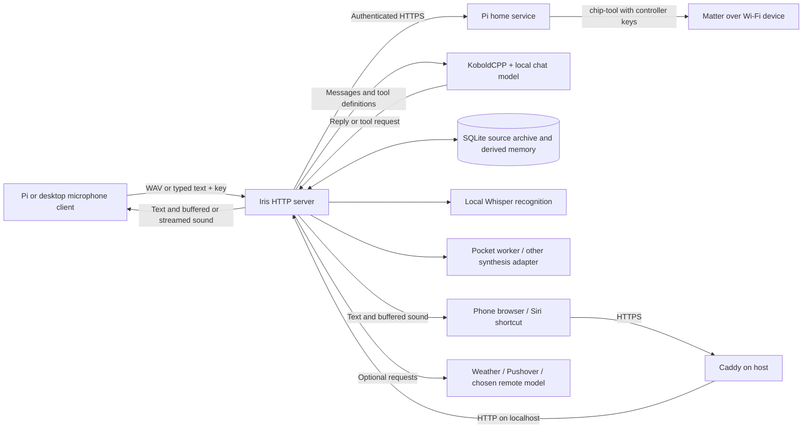
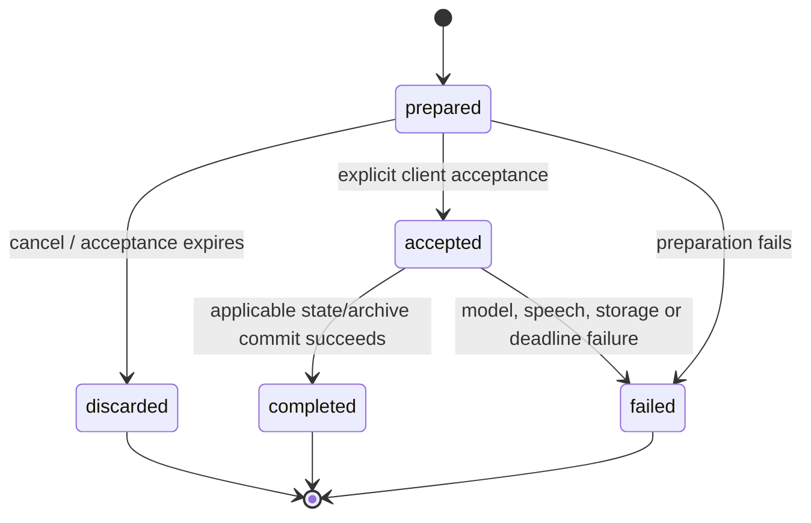

# Understanding Iris, from the first word to the last sample

Iris is a collection of ordinary programs doing different jobs. The language
model writes words. A recogniser turns recorded speech into words. A synthesiser
turns the answer into sound. Iris connects those jobs, remembers the appropriate
conversations, and checks what a requested action is allowed to do.

You don't need to know how a neural network is trained to understand this system.
Start here, then use the linked references when you want exact field names or a
particular implementation. For installation instead, choose the
[Windows](setup-windows.md), [macOS](setup-macos.md) or [Ubuntu](setup-linux.md) route.
Each starts small; the Pi, display, phone and home devices are additions.

## Programs, models and machines

A **process** is a running program with its own memory. A **model** is a large
collection of learned numerical weights stored in files. **Inference** means
running those weights on an input to produce an output. A **runtime**, such as
KoboldCPP, loads a model and performs inference. Downloading a model file does not
start a runtime, and starting Iris does not start KoboldCPP for you.

A **server** waits for requests; a **client** sends them. These describe jobs, not
sizes of computer. A Pi is Iris's client but also a server for its local face and,
optionally, home automation. Both halves of Iris can run on one computer. A phone
can replace the microphone client without changing where the language model runs.

The arrows describe information flow, not separate physical boxes in every case.
Whisper normally runs in the Iris process. Pocket and Chatterbox run in child
processes with their own Python environments. Kokoro runs in-process. The home
service is independent: its schedules can continue while the chat PC is asleep.

An **API** is a contract between programs. Iris uses HTTP, the same request and
response protocol used by websites, with JSON objects for structured values.
JSON is a text format for named values, lists, numbers and booleans such as
`true`; for example, `{"device":"lamp","state":"on"}` names two values.
HTTP headers carry accompanying metadata such as the content type and key.
An address such as `http://127.0.0.1:5001/v1` names a protocol, machine, **port**
(numbered listening endpoint) and path. `127.0.0.1` always means the computer
making the request. The Pi must use the PC's LAN address to reach Iris; the PC
can still use localhost to reach its model. `0.0.0.0` is a server bind address,
meaning all IPv4 interfaces, not an address to put into a phone.

HTTP does not encrypt the connection. HTTPS adds TLS encryption and a certificate
that the client uses to check the server's identity. A reverse proxy such as Caddy
terminates HTTPS and forwards to Iris locally. The connection key authenticates
requests; it does not replace encryption. A phone's microphone also needs a trusted
secure browser context. See [network and wire details](interfaces.md).
“Bearer” means possession of the key authorizes the request. It is a shared
password-like secret, distinct from the model's text tokens and session UUIDs.

## What the language model receives

A **token** is a unit used by a model to represent text, often part of a word.
A **context window** is the total space the runtime allocates to the input and
output of one generation. The advertised maximum is not necessarily the runtime's
current allocation. Set `model_context_tokens` to the allocation actually used by
KoboldCPP, and leave room for the answer and formatting.

A prompt is the input assembled for the model: system instructions, conversation
style, selected personality, recent exchanges, eligible memory evidence, the new
request and available tool definitions. It is not the complete lifetime archive.
`history_turns`, character budgets and the token estimator bound the view Iris
sends. A conservative estimate cannot reproduce every provider's exact tokenizer;
the margin exists because the host adds formatting too.

`temperature` controls sampling variability; it does not buy more context.
`max_tokens` caps reply generation. A length-limited answer can be incomplete.
Completion metadata from the provider helps distinguish that condition, especially
when Iris validates structured memory output. Increasing a limit without matching
the host allocation can produce a different failure rather than a better answer.

Tools are structured requests made by the model, not Python code the model gets
to execute. `ToolRegistry` advertises configured skills, validates JSON arguments
against their Pydantic schemas, dispatches the registered callable and returns the
result to the conversation loop. Pydantic is the library checking types, required
fields and limits at these boundaries. Unknown tools and invalid arguments fail.
The model/runtime must support tool calling for clock, home and notification
skills; conversational fluency alone does not establish that support.

## A typed conversation, step by step

1. The client sends UTF-8 (a standard text encoding) with a bearer key and a session UUID. A UUID is an
   opaque identifier, not an account credential. It groups that client's turns.
2. The HTTP adapter authenticates and admits the request within the connection,
   body-size and upload limits. Only a complete upload enters the FIFO queue.
   FIFO means first completed upload in, first turn out; a slow upload doesn't
   hold up a small completed request by occupying the brain.
3. `TurnCoordinator` owns serial execution. It refreshes shared privacy policy,
   obtains the text and checks exact controls before model conversation. “Private
   mode on” is a control with defined semantics, not a suggestion to the model.
4. For a conversational turn, Iris restores the source-linked conversation state,
   takes a reversible session checkpoint and prepares memory evidence. Summaries
   and metadata passes can call the model before the visible answer is generated.
5. The chat backend translates messages into its provider's wire format. Tool
   requests may lead to further model calls; the loop has explicit call/deadline
   limits. External effects have separate attempt records.
6. The reply service prepares the result. Text-only turns do not synthesise audio.
   The coordinator commits eligible original source text after the applicable
   acceptance and policy checks, then returns completion information.
7. The adapter sends the reply. A durable server commit does not prove that the
   client received or displayed it. If the connection fails at this point, an
   automatic retry could repeat an external action, so Iris does not retry blindly.

## Speech adds capture, recognition and playback

**STT** means speech to text. **TTS** means text to speech. **VAD** means voice
activity detection: deciding whether a stretch of sound is speech, not what was
said. Wake detection is another small recogniser looking for a local phrase.
None of these is the main conversational language model.

Sound is a sequence of samples. The **sample rate** says how many values represent
one second; a channel is one stream of values, so mono has one channel. **PCM** is
uncompressed sample data. A WAV file adds headers describing PCM. Mixing up a
recording's true sample rate with its declared rate changes its speed and pitch.

The Python client uses SpeechRecognition/PyAudio for capture and sounddevice for
playback. Their device indices belong to different lists. It calibrates or uses
the configured fixed energy threshold, applies pause and recording limits and,
if enabled, local Silero VAD. The browser captures through its audio worklet,
segments speech locally and converts its recording to mono 16 kHz PCM WAV.
Recordings travel in memory; `--save-reply` is an explicit diagnostic exception
for returned audio, and `--echo-recording` plays the captured input locally.

Whisper is loaded through `faster-whisper`. `base.en` is the default recognition
model, not a claim about the model in an existing configuration. The normal CPU
profile uses int8 computation; CUDA needs the matching hardware/runtime libraries.
Whisper's local model cache must already be prepared. Apple GPU support in a chat
runtime does not mean that this Whisper adapter uses Apple's Metal accelerator.

For a spoken turn, recognition supplies the text in step 3, and synthesis supplies
audio in step 6. Buffered replies contain a base64 WAV: base64 is a text encoding
for binary bytes inside JSON. Pocket can instead yield mono 16-bit PCM chunks at
24 kHz. The Python client can play those while later chunks are being generated.
The chat reply text has already been generated; this is synthesis streaming, not
word-by-word language-model streaming. Browser chat gets a complete WAV.

Normal capture and playback are **half-duplex**: the client does one at a time.
Voice cancellation is a separate optional listener. The client adds a configurable
playback lead-in for hardware that misses the opening samples. Optional feedback
sounds can fail without preventing capture; actual reply playback failures remain
errors. `--no-sounds` suppresses optional cues and working sound, while voice-cancel
acknowledgement remains audible. Text mode is silent.

## Acceptance, cancellation and partial outcomes

“Prepared”, “accepted”, “committed” and “delivered” describe different events.
Ordinary requests begin accepted. With voice cancellation enabled, a turn begins
provisionally: Iris can recognise and prepare reversible work, but a control,
external effect or reply delivery must pass the acceptance gate. The client stops
its local cancel listener before accepting. If it cannot establish that the
listener stopped, it cannot safely accept the turn.

An unaccepted discard restores reversible session state, including nested message
history and displaced cache entries. A newer shared privacy policy supersedes
that restoration. An external switch action is not reversible session state:
a lamp may have switched even if the following response or speech fails.
`TurnEffects` retains attempted/returned/uncertain receipts outside the checkpoint.
Equivalent validated effect arguments are not silently re-executed in one turn.
There is no cross-request exactly-once guarantee.

Short privacy, confirmed-detail and confirmed-forgetting controls prepare their
complete spoken acknowledgement before changing persistent state. If synthesis
fails, the change is not applied. Streamed conversation is different: some audio
can have played before the archive commit fails. The stream then ends in failure,
not an authoritative success. Clients negotiating completion metadata must require
a valid terminal event; a `start` frame alone is insufficient.

Closing a browser tab aborts its request and retires the local request identity.
It does not automatically retract work already accepted by the server. A later
personality selection also has its own revision, so an older reply cannot undo it.
These boundaries are specified in [runtime contracts](runtime-contracts.md).

## Memory is several different things

The **source archive** stores the full original text of completed non-private
exchanges in SQLite. SQLite is an embedded database, so it is a file managed by
the application, not another database server to install. A **transaction** makes
a group of database changes succeed or fail together. A schema specifies the
tables and relationships; a migration upgrades that structure transactionally.
Schema 9 is the current layout. Supported old fixtures cover versions 1–9; future
schemas are refused rather than guessed at.

The source archive has no automatic expiry, exchange-count cap or summarisation
policy that replaces originals. Explicit confirmed forgetting and private-mode
exclusion are intentional exceptions. A smaller model context is never a reason
to delete archive history.

| Representation | Purpose | Can it replace originals? |
| --- | --- | --- |
| Completed source exchanges | Original user/assistant text, ordering and provenance | This is the durable source. |
| Recent session history | Fast conversational continuity for a client | No; it is bounded, mutable process memory. |
| Summaries and notes | Compact views with source references and current/superseded status | No; model-generated and rebuildable. |
| Search chunks and FTS index | Find lexical matches; FTS means full-text search | No; an index is a way to locate sources. |
| Embedding vectors | Find related meaning as well as exact words | No; values depend on the chosen embedding model. |
| Details, facts and attention | Explicit labelled details, interpreted facts and topical use | Some are user-maintained; corrections and use links have distinct semantics. |
| Exports and backups | Independent recovery/inspection copies | They retain whatever was present when copied. |

An **embedding** turns a passage into a numerical vector so related passages can
be compared. Iris combines bounded lexical/semantic candidates, date filters,
source checks and ordering rather than treating vector similarity as truth.
Semantic retrieval currently considers at most the newest 4,096 eligible
candidates for a query before scoring. An old topic outside an undated window can
still be found lexically or with a narrower date window. The history remains stored.

**Provenance** records which original sources support derived information.
Correction should supersede the relevant note, not hide unrelated notes from the
same exchange. Retrieval rechecks visibility, owner and source revisions; inference
completed after a privacy change, forgetting or rebuild cannot republish stale data.
Database read snapshots are short and coherent. Model inference does not hold an
open read snapshot or transaction while waiting on a model.

An **owner** is the configured archive/privacy identity. A **session** is a client
conversation cache identity. Clients connected to the same owner share persistent
policy; a new session UUID does not create an independent privacy boundary. Private
mode excludes new source persistence and eligible saved-memory use according to
policy. Prompt tracing and terminal output are separate copies: cancellation or
forgetting cannot erase logs or backups already made elsewhere.

Summary jobs and vector failures are durable. Bounded batches, fair summary queue
order and retry/backoff avoid one failed item starving every other item. A backlog
limits derived processing, never source retention. Some maintenance stays serial
because its output can affect the current answer. See [memory and privacy](memory-and-privacy.md)
for user controls and [memory storage](memory-storage.md) for the data dictionary,
SQL/migration boundaries, retry commands and verified restore procedure.

## Ownership, concurrency and shutdown

A **thread** is another execution path inside a process. A **lock** protects an
invariant while paths could otherwise interleave. A queue defines work ordering;
a timeout limits waiting. More threads do not automatically make a model or an
archive safe to use concurrently.

`iris_domain` defines values without opening devices or connections. `iris_app`
coordinates turns and owns state transitions. HTTP, microphone and browser-page
code are adapters: connectors translating those interfaces into application calls.
`iris_memory.repository` owns SQLite operations;
`schema` and `migrations` own upgrades. Provider backends translate model protocols.
Tool services have application lifetime, while registries belong to sessions.
The [architecture map](architecture.md) names the remaining modules and extensions.

The server allows bounded connection handlers, an admission limit including
uploads, and a FIFO queue for complete bodies. A coordinator lock also protects
direct non-HTTP callers. Cancellation decisions bypass ordinary turn admission.
Deadlines use elapsed monotonic time, which does not jump when the wall clock is
corrected. Calendar schedules need timezone-aware wall-clock time instead.

`ApplicationLifetime` leases keep resources alive while accepted work uses them.
Shutdown stops admission, signals cooperative cancellation and waits up to five
seconds for leases to drain. Cleanup happens once, after the final lease leaves.
A native in-process inference call cannot safely be killed by a Python thread;
it can outlast the drain wait, and its resources stay owned until it returns.

Pocket/Chatterbox worker messages carry protocol version and request identity.
Bounded frames and queues prevent an unresponsive or malformed child from filling
memory without limit. Startup/synthesis deadlines, failed state and limited later
restarts keep failures visible. An unfinished synthesis stream retires the worker;
ambiguous synthesis is not replayed. Worker environments exclude unrelated service
credentials. [Performance and recovery](performance-and-recovery.md) explains the
exact supervision limits and what timing measurements can and cannot establish.

Home scheduling separates its database lock from device I/O and orders operations
per device. It rechecks schedule revision/cursor before acting and before advancing
the cursor. An edit cannot retract a physical command already underway, but that
command cannot overwrite the edited schedule's cursor. The Matter controller's
fabric files have their own serialization. Fabric means the controller's paired
trust relationship and keys, not just a list of human-readable device names.

## Optional pieces and their boundaries

Wake mode uses a local Vosk model to open a conversation; silence or “Stop listening”
returns it to waiting. Companion mode can begin a turn after a randomized quiet
interval, with backoff after ignored openers. Optional archived follow-ups also
respect privacy, relevance, exclusions and cooldowns. Neither mode makes the model
an autonomous monitoring service for every household event.

Personalities add selected client prompts; the browser sends a configured name,
while the Python client can send its validated catalog context. The shared command
list lives in `iris_droid/web/commands.json`. The face uses bounded expression
values separate from spoken/archived text. The Pi's loopback face service shares
state with the native display or browser preview. Face choice persists separately
from a conversation; a phone tab's personality and in-tab transcript have different
lifetimes. The native console renderer uses the Pi's system Pygame/SDL environment.

The home service supports configured Matter switch/meter endpoints through
`chip-tool`. A **cluster** is a standardized group of device functions; an
**endpoint** is a numbered function set on a device. A weekly schedule belongs to
Iris's home database, not the plug manufacturer's app. After downtime Iris applies
the latest missed applicable change. Spring-forward nonexistent local times are
skipped; an autumn repeated time uses its first occurrence. Clock synchronization
can delay scheduling. See [home automation](home-automation.md).

The Siri shortcut sends text to `/v1/text` with its own stable session UUID, then
reads the JSON `text` field using the iPhone's voice. It does not request Pocket
speech. Siri/dictation and the phone's own privacy settings are outside Iris's
local-model guarantee. Weather sends configured location information to Open-Meteo;
Pushover sends explicitly requested notification content to its service. These have
separate opt-ins from a remote chat provider or Google STT. See
[phone access](phone-access.md) and [server setup](server-setup.md).

## Installation, updates and evidence

Most of Iris is written in Python. An interpreter runs its `.py` files; a package
is reusable code installed for that interpreter, and a dependency is a package
Iris needs. An optional installation extra selects additional dependencies for a
particular job. Browser code instead runs JavaScript inside the browser.

An editable install points Python at a checkout, so missing package assets can go
unnoticed. A wheel is the installable Python artifact; a source distribution also
contains the build inputs, guides and scripts. Artifact tests build a wheel from
an extracted source distribution and import it away from the checkout. Node is
needed only to change/check browser code or generate face artwork, not on the Pi
running the already committed PNGs. Model files and private configuration are not
bundled into either Python artifact.

A virtual environment isolates Python packages, not system drivers or GPU memory.
Pocket and Chatterbox need their own environments because their dependency sets
and processes differ. The model runtime has another lifecycle again. Startup
services must use explicit paths, the intended working directory and the correct
secret environment; an activated terminal doesn't configure a service.

Updates stop managed processes before changing code/dependencies and retain pending
state until completion checks pass. Windows verifies the new server identity;
systemd checks the original active/failed service set. Neither process readiness
proves a microphone or lamp works. Database rollback requires a compatible backup,
not just older source code. Read [updates](updates.md) before recovering a pending
marker, and use [release acceptance](releasing.md) for the real-device gates.

The [verification map](verification.md) connects features to automated checks and
remaining physical acceptance. Coverage shows what code was executed; it cannot
prove a useful assertion was made, a race was exercised, or a real model behaved.
For practical extensions, start with [the runnable recipes](extensions.md), then
preserve acceptance, source retention, deadline and ownership invariants at the
boundary you change.
